# asbh-feed

The live data feed for **African Sports Broadcast Hub**, the Windows and Android apps. It is non-commercial and has no ads.

The apps (2.1.8 and later) download [`feed.json`](feed.json) every time they refresh (about every 15 minutes), so changes reach every installed app over the air, with no reinstall.

<a id="download-the-apps"></a>
## ⬇️ Download the apps (latest: 2.3.0)

Free and non-commercial, with no ads. Please download, test and **send feedback by opening an [Issue](https://github.com/Kigakhemet98/asbh-feed/issues)**. All files are on the [`downloads`](https://github.com/Kigakhemet98/asbh-feed/tree/downloads/) branch (newest version only); checksums are in each folder's `SHA256SUMS.txt`. GitHub limits files to 100 MB, so big installers come in parts with a small **join** script that rebuilds and checks the file.

| Platform | Download | How to install |
|:---:|---|---|
| <br>**Android 17** | [AfricanSportsBroadcastHub-2.3.0.apk](https://github.com/Kigakhemet98/asbh-feed/raw/downloads/android/AfricanSportsBroadcastHub-2.3.0.apk) (48 MB) | Open it on your phone and allow *Install unknown apps* when asked. It installs over older versions and keeps your reminders. |
| <br>**Windows 11** | **x64** (Intel / AMD): [part 0](https://github.com/Kigakhemet98/asbh-feed/raw/downloads/windows/ASBH-Setup-2.3.0-x64.exe.part0) · [part 1](https://github.com/Kigakhemet98/asbh-feed/raw/downloads/windows/ASBH-Setup-2.3.0-x64.exe.part1) · [join-windows-2.3.0-x64.bat](https://github.com/Kigakhemet98/asbh-feed/raw/downloads/windows/join-windows-2.3.0-x64.bat)<br><br>**ARM64** (Snapdragon / Copilot+ PCs): [part 0](https://github.com/Kigakhemet98/asbh-feed/raw/downloads/windows/ASBH-Setup-2.3.0-arm64.exe.part0) · [part 1](https://github.com/Kigakhemet98/asbh-feed/raw/downloads/windows/ASBH-Setup-2.3.0-arm64.exe.part1) · [join-windows-2.3.0-arm64.bat](https://github.com/Kigakhemet98/asbh-feed/raw/downloads/windows/join-windows-2.3.0-arm64.bat) | Put the three files in one folder and double-click the **.bat** – it rebuilds the installer, checks it and starts it. If SmartScreen appears: *More info → Run anyway* (not code-signed). |
| <br>**macOS**<br>Apple Silicon (M1 and later) | [part 0](https://github.com/Kigakhemet98/asbh-feed/raw/downloads/mac/ASBH-2.3.0-mac-arm64.dmg.part0) · [part 1](https://github.com/Kigakhemet98/asbh-feed/raw/downloads/mac/ASBH-2.3.0-mac-arm64.dmg.part1) · [join](https://github.com/Kigakhemet98/asbh-feed/raw/downloads/mac/join-ASBH-2.3.0-mac-arm64.dmg.sh) | Put the files in one folder, then in Terminal: `sh join-ASBH-2.3.0-mac-arm64.dmg.sh`. Open the DMG and drag the app to **Applications**. The app isn't notarised by Apple: the first time, right-click it → **Open** → **Open** (or run `xattr -cr "/Applications/African Sports Broadcast Hub.app"`). |
| <br>**Linux** | deb, rpm, Arch (pkg.tar.zst), tar.xz, snap and flatpak – see the table below | Download the parts and the join script for your format, run `sh join-….sh`, then install as shown below. |

**Linux packages** – download the parts and the join script, then run `sh join-<file>.sh` in that folder.

| Format | x64 (Intel / AMD) | ARM64 | Install |
|:---:|---|---|---|
|  <br>**deb** – Debian, Ubuntu, Mint, Pop!_OS | [part 0](https://github.com/Kigakhemet98/asbh-feed/raw/downloads/linux/african-sports-broadcast-hub-2.3.0-amd64.deb.part0) · [part 1](https://github.com/Kigakhemet98/asbh-feed/raw/downloads/linux/african-sports-broadcast-hub-2.3.0-amd64.deb.part1) · [join](https://github.com/Kigakhemet98/asbh-feed/raw/downloads/linux/join-african-sports-broadcast-hub-2.3.0-amd64.deb.sh) | [part 0](https://github.com/Kigakhemet98/asbh-feed/raw/downloads/linux/african-sports-broadcast-hub-2.3.0-arm64.deb.part0) · [part 1](https://github.com/Kigakhemet98/asbh-feed/raw/downloads/linux/african-sports-broadcast-hub-2.3.0-arm64.deb.part1) · [join](https://github.com/Kigakhemet98/asbh-feed/raw/downloads/linux/join-african-sports-broadcast-hub-2.3.0-arm64.deb.sh) | `sudo apt install ./african-sports-broadcast-hub-2.3.0-amd64.deb` |
|  <br>**rpm** – Fedora, RHEL, openSUSE | [part 0](https://github.com/Kigakhemet98/asbh-feed/raw/downloads/linux/african-sports-broadcast-hub-2.3.0-x86_64.rpm.part0) · [part 1](https://github.com/Kigakhemet98/asbh-feed/raw/downloads/linux/african-sports-broadcast-hub-2.3.0-x86_64.rpm.part1) · [join](https://github.com/Kigakhemet98/asbh-feed/raw/downloads/linux/join-african-sports-broadcast-hub-2.3.0-x86_64.rpm.sh) | [part 0](https://github.com/Kigakhemet98/asbh-feed/raw/downloads/linux/african-sports-broadcast-hub-2.3.0-aarch64.rpm.part0) · [part 1](https://github.com/Kigakhemet98/asbh-feed/raw/downloads/linux/african-sports-broadcast-hub-2.3.0-aarch64.rpm.part1) · [join](https://github.com/Kigakhemet98/asbh-feed/raw/downloads/linux/join-african-sports-broadcast-hub-2.3.0-aarch64.rpm.sh) | `sudo dnf install ./african-sports-broadcast-hub-2.3.0-x86_64.rpm` |
| <br>**pkg.tar.zst** – Arch, Manjaro, EndeavourOS | [part 0](https://github.com/Kigakhemet98/asbh-feed/raw/downloads/linux/african-sports-broadcast-hub-2.3.0-x64.pkg.tar.zst.part0) · [part 1](https://github.com/Kigakhemet98/asbh-feed/raw/downloads/linux/african-sports-broadcast-hub-2.3.0-x64.pkg.tar.zst.part1) · [join](https://github.com/Kigakhemet98/asbh-feed/raw/downloads/linux/join-african-sports-broadcast-hub-2.3.0-x64.pkg.tar.zst.sh) | [part 0](https://github.com/Kigakhemet98/asbh-feed/raw/downloads/linux/african-sports-broadcast-hub-2.3.0-aarch64.pkg.tar.zst.part0) · [part 1](https://github.com/Kigakhemet98/asbh-feed/raw/downloads/linux/african-sports-broadcast-hub-2.3.0-aarch64.pkg.tar.zst.part1) · [join](https://github.com/Kigakhemet98/asbh-feed/raw/downloads/linux/join-african-sports-broadcast-hub-2.3.0-aarch64.pkg.tar.zst.sh) | `sudo pacman -U african-sports-broadcast-hub-2.3.0-x64.pkg.tar.zst` |
| <br>**tar.xz** – any distribution | [part 0](https://github.com/Kigakhemet98/asbh-feed/raw/downloads/linux/african-sports-broadcast-hub-2.3.0-x64.tar.xz.part0) · [part 1](https://github.com/Kigakhemet98/asbh-feed/raw/downloads/linux/african-sports-broadcast-hub-2.3.0-x64.tar.xz.part1) · [join](https://github.com/Kigakhemet98/asbh-feed/raw/downloads/linux/join-african-sports-broadcast-hub-2.3.0-x64.tar.xz.sh) | [part 0](https://github.com/Kigakhemet98/asbh-feed/raw/downloads/linux/african-sports-broadcast-hub-2.3.0-arm64.tar.xz.part0) · [part 1](https://github.com/Kigakhemet98/asbh-feed/raw/downloads/linux/african-sports-broadcast-hub-2.3.0-arm64.tar.xz.part1) · [join](https://github.com/Kigakhemet98/asbh-feed/raw/downloads/linux/join-african-sports-broadcast-hub-2.3.0-arm64.tar.xz.sh) | `tar xf african-sports-broadcast-hub-2.3.0-x64.tar.xz`, then run `./african-sports-broadcast-hub` inside the folder |
| <br>**snap** | [part 0](https://github.com/Kigakhemet98/asbh-feed/raw/downloads/linux/african-sports-broadcast-hub-2.3.0-amd64.snap.part0) · [part 1](https://github.com/Kigakhemet98/asbh-feed/raw/downloads/linux/african-sports-broadcast-hub-2.3.0-amd64.snap.part1) · [join](https://github.com/Kigakhemet98/asbh-feed/raw/downloads/linux/join-african-sports-broadcast-hub-2.3.0-amd64.snap.sh) | — | `sudo snap install --dangerous ./african-sports-broadcast-hub-2.3.0-amd64.snap` (not from the Snap Store) |
| <br>**flatpak** | [part 0](https://github.com/Kigakhemet98/asbh-feed/raw/downloads/linux/african-sports-broadcast-hub-2.3.0-x86_64.flatpak.part0) · [part 1](https://github.com/Kigakhemet98/asbh-feed/raw/downloads/linux/african-sports-broadcast-hub-2.3.0-x86_64.flatpak.part1) · [join](https://github.com/Kigakhemet98/asbh-feed/raw/downloads/linux/join-african-sports-broadcast-hub-2.3.0-x86_64.flatpak.sh) | — | `flatpak install --user ./african-sports-broadcast-hub-2.3.0-x86_64.flatpak` (uses the Flathub runtime) |

Matches, channels and numbers update **over the air** from `feed.json`; from version 2.2.9 the apps also show a banner when a newer version is out.

## What's new in 2.2.8 (13 Nov 2026)

- **Zuku TV** added (logo, landing page, channel list): new **Punch TV** combat-sports channel (714), Liverpool TV (721), plus ESPN 712/713 and SportyTV 720 on Zuku, with packages.

## What's new in 2.3.0 (14 Nov 2026)

- **NBA:** live games with their African and Middle East broadcasters straight from nba.com's schedule (Pan-Africa: CANAL+ Afrique, SuperSport Action, ESPN, SportyTV; Pan-Middle East incl. North Africa: beIN SPORTS and Prime Video; South Africa: ESPN and Prime Video), merged with SuperSport, beIN and Sport 24's own guides. Updated every 3 hours in the feed and every 2 hours in the apps.
- NBA team names unified ("Dallas", "Mavericks", "DAL" → Dallas Mavericks) so the same game is listed once.

## What's new in 2.2.9 (13 Nov 2026)

- **New platforms:** macOS (Apple Silicon DMG), Linux (deb, rpm, pkg.tar.zst, tar.xz, snap, flatpak – x64, plus ARM64 for deb/rpm/Arch/tar) and Windows on ARM64.
- Apps announce new versions over the air (banner with a download link).
- Downloads moved to the `downloads` branch so the repository stays small.

## What's new in 2.2.7 (13 Nov 2026)

- ESPN Africa channel numbers on every platform (DStv, Azam, StarTimes, Zuku, ZAP, GOtv) and landing pages, incl. Disney+ South Africa.

## What's new in 2.2.6 (13 Nov 2026)

- SportyTV on GOtv from **Starter** up in every GOtv region (Kenya 558, Nigeria 58, Ghana 36).
- Azam Sports 1–5 HD numbered 111–115.
- ESPN Africa is no longer DStv-exclusive: ESPN / ESPN 2 numbers on DStv, Azam, StarTimes, Zuku, ZAP and GOtv, plus Disney+ (South Africa), with landing pages for each.

## What's new in 2.2.5 (13 Nov 2026)

- **SportyTV** linear channel on DStv (236 South Africa & Nigeria, 237 Kenya & Ghana) and GOtv (558 Kenya, 58 Nigeria, 36 Ghana – GOtv Starter and up), launched 10 June 2026 – in both apps and over the air.
- SuperSport Swahili DStv 216; GOtv and DStv package lists (November 2026).
- Azam Sports 1–5 HD channel numbers: Azam TV 111–115 (satellite and DTT).

## What's new in 2.2.3 (13 Nov 2026)

- **DAZN schedule** documented here: the apps read DAZN's live 10-day schedule on the device (DAZN blocks requests from GitHub's servers).
- Broadcaster and channel logos in this README.
- SuperSport Swahili: **DStv 216** (East Africa – Kenya, Uganda; DStv Select in Tanzania). GOtv numbers for SuperSport now have their own table (*SuperSport on GOtv*), with GOtv's new packages from 5 Nov 2026 (Easy · Starter · Select · Sports), and each SuperSport channel's DStv package (Starter · Select · Sports · Ultimate) – from MultiChoice's November 2026 package channel list.

- SuperSport's landing page is now **DStv Stream – [dstv.stream](https://dstv.stream/#/)** (DStv and SuperSport.com stay as extra links).
- EuroLeague 2026-27 club crests (all 20 teams, plus AS Monaco).

## What's new in 2.2.2 (13 Nov 2026)

- **Sport 24 & Sport 24 Extra** (live sport on airlines and cruise ships) – new broadcaster; its 10-day live schedule is read every run.
- **Channel numbers:** SuperSport as *Rest of Africa · South Africa* (e.g. Rugby DStv 231 · 211; LaLiga DStv 224 · 204), CANAL+ SPORT 1–5 = 11–15, beIN SPORTS MENA (1–9, XTRA 41–49, MAX 701–706, English 21–22, French 26–27).
- **Logos:** French handball, AFL/AFLW, NWSL, college football, Liga ACB, LPB clubs; U21/women's national sides (flags); ICC (dark mode), Total Chess, Freestyle Friday, E1, WTCS, OCEANMAN, T100, World Skate, Legends Cup, Boxing and more; Beta Sports and Sporty TV.
- Guide shorthand ("LI: MCI v FUL", Diski club codes, "Ottowa") is expanded the same way in the feed and in the apps.

## Broadcasters, rights and where to watch

Generated from the apps' own data (`web/js/data-channels.js`). **Watch** links go to the broadcaster's stream or decoder page. SuperSport numbers read *Rest of Africa · South Africa* (e.g. SuperSport Rugby **DStv 231 · 211**).

### SuperSport


*DStv · GOtv · DStv Stream · channel numbers: Rest of Africa · South Africa*

- **Watch:** [DStv Stream](https://dstv.stream/#/) · [DStv](https://www.dstv.com) · [SuperSport](https://supersport.com)

| Logo | Channel | Number | DStv package (from 5 Nov 2026) |
|:---:|---|---|---|
|  | SuperSport WWE | DStv 128 · ROA 226 | DStv Select and up |
|  | SuperSport Events | DStv 199 | DStv Sports and up |
|  | SuperSport Swahili (East Africa – Kenya · Uganda · Tanzania) | DStv 216 | DStv Sports and up |
|  | SuperSport Extra 2 | DStv 217 · South Africa only | DStv Ultimate |
|  | SuperSport Blitz | DStv 220 · 200 | DStv Starter and up |
|  | SuperSport Grandstand | DStv 221 · 201 | DStv Ultimate |
|  | SuperSport Football Plus | DStv 222 · 206 | DStv Sports and up |
|  | SuperSport Premier League | DStv 223 · 203 | DStv Sports and up |
|  | SuperSport LaLiga | DStv 224 · 204 | DStv Starter and up |
|  | SuperSport Football | DStv 225 · 205 | DStv Select and up |
|  | SuperSport KickOff | DStv 227 · 207 | DStv Starter and up |
|  | SuperSport Africa | DStv 228 · 208 | DStv Starter and up |
|  | SuperSport Action | DStv 229 · 209 | DStv Sports and up |
|  | SuperSport Extra | DStv 230 · 210 | DStv Ultimate |
|  | SuperSport Rugby | DStv 231 · 211 | DStv Ultimate |
|  | SuperSport Cricket | DStv 232 · 212 | DStv Ultimate |
|  | SuperSport Golf | DStv 233 · 213 | DStv Ultimate |
|  | SuperSport Tennis | DStv 234 · 214 | DStv Ultimate |
|  | SuperSport Motorsport | DStv 235 · 215 | DStv Ultimate |
|  | SuperSport Máximo 1 | DStv 241 · Angola/Moz 601 | DStv Ultimate |
|  | SuperSport Máximo 2 | DStv 242 · Angola/Moz 602 | DStv Ultimate |
| 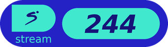 | SuperSport AWSN | DStv Stream 244 | DStv App |
|  | SuperSport Stream 245 | DStv Stream 245 | DStv App |
| 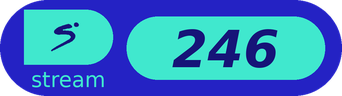 | SuperSport Stream 246 | DStv Stream 246 | DStv App |
|  | SuperSport Stream 247 | DStv Stream 247 | DStv App |
| 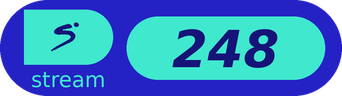 | SuperSport Stream 248 | DStv Stream 248 | DStv App |
|  | SuperSport Stream 950 | DStv Stream 950 | DStv App |
|  | SuperSport Stream 951 | DStv Stream 951 | DStv App |
| 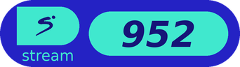 | SuperSport Stream 952 | DStv Stream 952 | DStv App |

#### SuperSport on GOtv

Source: MultiChoice *New DStv & GOtv Package Channel List – November 2026* (DTT sheet, Uganda numbering) and gotvafrica.com/en-ke. Kenya carries the same channels in the 500s ([GOtv Kenya](https://www.gotvafrica.com/en-ke/packages/gotv-starter/) lists Blitz 560, KickOff 561, Africa 562, LaLiga 563; Swahili is 570). Packages from 5 November 2026: **Easy · Starter · Select · Sports** – the package shown is the lowest one that includes the channel.

| Logo | Channel | GOtv Uganda | GOtv Kenya | Package |
|:---:|---|---|---|---|
|  | SuperSport Blitz | 360 | 560 | GOtv Easy and up |
|  | SuperSport KickOff | 361 | 561 | GOtv Starter and up |
|  | SuperSport Africa | 362 | 562 | GOtv Easy and up |
|  | SuperSport LaLiga | 363 | 563 | GOtv Starter and up |
|  | SuperSport Premier League | 364 | 564 | GOtv Sports |
|  | SuperSport Football | 365 | 565 | GOtv Select and up |
|  | SuperSport Football Plus | 366 | 566 | GOtv Sports |
|  | SuperSport Action | 367 | 567 | GOtv Sports |
|  | SuperSport Extra | 368 | 568 | GOtv Sports |
|  | SuperSport WWE | 369 | 569 | GOtv Select and up |
|  | SuperSport Swahili | 370 | 570 | GOtv Sports |

- **Rights tracked:** AFCON PAMOJA 2027 qualifiers – channel TBA; ATP & WTA tennis – SuperSport Tennis; Premier League – SuperSport Premier League; LaLiga (every match) – SuperSport LaLiga
- Everything SuperSport marks LIVE in its own guide (football, rugby, cricket, golf, motorsport, WWE, schools sport and more) is added automatically.

### CANAL+ Afrique


*CANAL+ · myCANAL Afrique*

- **Watch:** [CANAL+ Afrique](https://www.canalplus-afrique.com) · [myCANAL Afrique](https://www.canalplus.com/)

| Logo | Channel | Number |
|:---:|---|---|
|  | CANAL+ SPORT 1 | CANAL+ 11 |
|  | CANAL+ SPORT 2 | CANAL+ 12 |
| 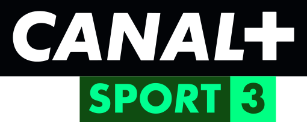 | CANAL+ SPORT 3 | CANAL+ 13 |
|  | CANAL+ SPORT 4 | CANAL+ 14 |
|  | CANAL+ SPORT 5 | CANAL+ 15 |

- **Rights tracked:** AFCON PAMOJA 2027 qualifiers (French) – CANAL+ Sport (chaîne à confirmer); ATP tennis – CANAL+ SPORT 5; WTA tennis – CANAL+ SPORT 5; UEFA Champions League – CANAL+ SPORT 2; Premier League – CANAL+ SPORT 3; LaLiga – CANAL+ SPORT 4; Ligue 1 – CANAL+ SPORT 1; Bundesliga – CANAL+ SPORT 1; NBA – CANAL+ SPORT 4; Formula 1 – CANAL+ SPORT 4; MotoGP – CANAL+ SPORT 1; Top 14 – CANAL+ SPORT 1
- CANAL+ SPORT 1–5 (channels 11–15 on CANAL+ Afrique). Its guide blocks automated reads, so matches come from announcements.

### StarTimes

<picture><source media="(prefers-color-scheme: dark)" srcset="logos/readme/providers/startimes-dark.png"></picture>

*StarTimes ON · DTT · DTH*

- **Watch:** [StarTimes](https://www.startimestv.com) · [StarTimes ON](https://m.startimestv.com/browser/live)

| Logo | Channel | Number |
|:---:|---|---|
| <picture><source media="(prefers-color-scheme: dark)" srcset="logos/readme/channels/st-sports-focus-on-dark.png"></picture> | StarTimes Sports Focus | DTH 240 · DTT 256 |
| <picture><source media="(prefers-color-scheme: dark)" srcset="logos/readme/channels/st-sports-arena-on-dark.png"></picture> | StarTimes Sports Arena | DTH 241 · DTT 257 |
| <picture><source media="(prefers-color-scheme: dark)" srcset="logos/readme/channels/st-sports-life-on-dark.png"></picture> | StarTimes Sports Life | DTH 243 · DTT 253 |
| <picture><source media="(prefers-color-scheme: dark)" srcset="logos/readme/channels/st-beta-on-dark.png"></picture> | StarTimes Beta Sports (Nigeria) | DTH 244 · Nigeria |
| <picture><source media="(prefers-color-scheme: dark)" srcset="logos/readme/channels/st-world-football-on-dark.png"></picture> | StarTimes World Football | DTH 245 · DTT 260 |
| <picture><source media="(prefers-color-scheme: dark)" srcset="logos/readme/channels/st-sports-premium-on-dark.png"></picture> | StarTimes Sports Premium | DTH 246 · DTT 259 |

- **Rights tracked:** LaLiga – StarTimes Sports Premium; Bundesliga – StarTimes World Football; Carabao Cup – StarTimes World Football; Saudi Pro League – StarTimes Sports Premium; Uganda Premier League – Sanyuka Prime; AEW Wrestling – StarTimes Sports Arena; AFC Asian Cup – channel TBA
- StarTimes slots are confirmed automatically when they line up with a real kick-off. Beta Sports (DTH 244) is Nigeria only.

### Azam Sports


*Azam TV · Azam TV Max*

- **Watch:** [Azam TV](https://azamtv.com) · [Azam TV Max](https://web.azamtvmax.com)

| Logo | Channel | Number |
|:---:|---|---|
|  | Azam Sports 1 HD | Azam TV 111 |
|  | Azam Sports 2 HD | Azam TV 112 |
|  | Azam Sports 3 HD | Azam TV 113 |
|  | Azam Sports 4 HD | Azam TV 114 |
|  | Azam Sports 5 HD | Azam TV 115 |

- **Rights tracked:** LaLiga – Azam Sports 4 HD; Bundesliga – Azam Sports 2 HD; Serie A – Azam Sports 3 HD; Carabao Cup – Azam Sports 1 HD; Women's Super League – Azam Sports 1 HD; CAF Women's Champions League – Azam Sports 1 HD; AFCON 2027 Qualifiers – Azam Sports 2 HD; AFC Asian Cup – channel TBA
- Live matches from the Azam TV Max guide (titles marked LIVE).

### ZBC (Zanzibar)


*On Azam TV*

- **Watch:** [Azam TV (ZBC)](https://azamtv.com)

| Logo | Channel | Number |
|:---:|---|---|
| <picture><source media="(prefers-color-scheme: dark)" srcset="logos/readme/channels/zbc2-on-dark.png"></picture> | ZBC 2 | — |

- ZBC 2 shows selected Azam football in Zanzibar.

### Free-to-air (national TV)


*Selected matches*

- **Watch:** —

| Logo | Channel | Number |
|:---:|---|---|
|  | Sanyuka Prime | DTT 251 · DTH 238 |
|  | SABC Sport (South Africa) | — |
|  | Botswana TV (Botswana) | — |
|  | RTI (Côte d'Ivoire) | — |
|  | RTNC (DR Congo) | — |
|  | CRTV (Cameroon) | — |
|  | SNRT Arryadia (Morocco) | — |
|  | ON Time Sports (Egypt) | — |
|  | RBA (Rwanda) | — |

- National broadcasters (e.g. Sanyuka Prime in Uganda).

### beIN SPORTS MENA


*beIN · TOD*

- **Watch:** [beIN SPORTS MENA](https://www.beinsports.com/en-mena/) · [TOD](https://www.tod.tv) · [beIN SPORTS CONNECT](https://connect.beinsports.com)

| Logo | Channel | Number |
|:---:|---|---|
|  | beIN SPORTS 1 | beIN 1 |
|  | beIN SPORTS 2 | beIN 2 |
|  | beIN SPORTS 3 | beIN 3 |
|  | beIN SPORTS 4 | beIN 4 |
|  | beIN SPORTS 5 | beIN 5 |
|  | beIN SPORTS 6 | beIN 6 |
|  | beIN SPORTS 7 | beIN 7 |
|  | beIN SPORTS 8 | beIN 8 |
|  | beIN SPORTS 9 | beIN 9 |
|  | beIN SPORTS 10 | beIN 10 |
|  | beIN SPORTS News | beIN 10 |
|  | beIN SPORTS | beIN 11 |
|  | beIN 4K | beIN 14 |
|  | beIN SPORTS English 1 | beIN 21 |
|  | beIN SPORTS English 2 | beIN 22 |
|  | beIN SPORTS French 1 | beIN 26 |
|  | beIN SPORTS French 2 | beIN 27 |
|  | beIN SPORTS XTRA 1 | beIN 41 |
|  | beIN SPORTS XTRA 2 | beIN 42 |
|  | beIN SPORTS XTRA 3 | beIN 43 |
|  | beIN SPORTS XTRA 4 | beIN 44 |
|  | beIN SPORTS XTRA 5 | beIN 45 |
|  | beIN SPORTS XTRA 6 | beIN 46 |
|  | beIN SPORTS XTRA 7 | beIN 47 |
|  | beIN SPORTS XTRA 8 | beIN 48 |
|  | beIN SPORTS XTRA 9 | beIN 49 |
| 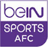 | beIN SPORTS AFC | — |
| 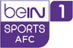 | beIN SPORTS AFC 1 | — |
| 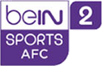 | beIN SPORTS AFC 2 | — |
| 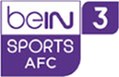 | beIN SPORTS AFC 3 | — |
| 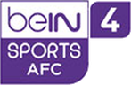 | beIN SPORTS AFC 4 | — |
| 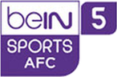 | beIN SPORTS AFC 5 | — |
| 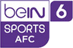 | beIN SPORTS AFC 6 | — |
| 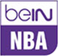 | beIN NBA | — |
|  | beIN SPORTS MAX 1 | beIN 701 |
|  | beIN SPORTS MAX 2 | beIN 702 |
|  | beIN SPORTS MAX 3 | beIN 703 |
|  | beIN SPORTS MAX 4 | beIN 704 |
|  | beIN SPORTS MAX 5 | beIN 705 |
|  | beIN SPORTS MAX 6 | beIN 706 |

- **Rights tracked:** Premier League – beIN SPORTS 1, beIN SPORTS English 1, beIN 4K; AFCON PAMOJA 2027 qualifiers – channel TBA; AFC Asian Cup – channel TBA; ATP tennis – channel TBA; LaLiga – beIN SPORTS 1, beIN SPORTS English 1; Carabao Cup – beIN SPORTS 1, beIN SPORTS English 1; Formula 1 – beIN SPORTS 8, beIN SPORTS English 1, beIN 4K; MotoGP – beIN SPORTS 8, beIN SPORTS English 1; NBA – beIN SPORTS 7, beIN SPORTS English 1; NFL – beIN SPORTS 8, beIN SPORTS English 2
- Everything beIN marks live in its MENA guide.

### ESPN Africa


*Flagship on DStv, no longer DStv-exclusive · also on GOtv, Azam TV, StarTimes, Zuku, ZAP and Disney+ (South Africa)*

- **Watch:** [ESPN Africa](https://africa.espn.com) · [DStv Stream](https://dstv.stream/#/) · [GOtv](https://www.gotvafrica.com) · [Azam TV Max](https://web.azamtvmax.com) · [StarTimes ON](https://m.startimestv.com/browser/live) · [Zuku](https://zuku.co.ke) · [ZAP](https://www.zap.co.ao) · [Disney+ (South Africa)](https://www.disneyplus.com/en-za)

| Logo | Channel | Number |
|:---:|---|---|
|  | ESPN | DStv 218 · Azam 120 · StarTimes 248 · Zuku 712 · ZAP 31 |
|  | ESPN 2 | DStv 219 · Azam 121 · StarTimes 249 · Zuku 713 · ZAP 32 |

**Where to find ESPN and ESPN 2**

| Platform | ESPN | ESPN 2 | Where |
|---|---|---|---|
| <a href="https://dstv.stream/#/"><picture><source media="(prefers-color-scheme: dark)" srcset="logos/readme/platforms/dstv-dark.png"></picture></a><br>DStv (flagship) | 218 | 219 | Across Africa |
| <a href="https://web.azamtvmax.com"><picture><source media="(prefers-color-scheme: dark)" srcset="logos/readme/platforms/azamtv-dark.png"></picture></a><br>Azam TV | 120 | 121 | East & Southern Africa |
| <a href="https://m.startimestv.com/browser/live"><picture><source media="(prefers-color-scheme: dark)" srcset="logos/readme/platforms/startimes-dark.png"></picture></a><br>StarTimes | 248 | 249 | Across Africa |
| <a href="https://zuku.co.ke"><picture><source media="(prefers-color-scheme: dark)" srcset="logos/readme/platforms/zuku-dark.png"></picture></a><br>Zuku (Wananchi) | 712 (Smart and up) | 713 (Smart Plus and up) | Kenya & East Africa |
| <a href="https://www.zap.co.ao"></a><br>ZAP | 31 | 32 | Angola & Mozambique |
| <a href="https://www.gotvafrica.com"></a><br>GOtv | 556 Kenya · 356 Uganda (Starter and up) | 357 Uganda (Sports) | Kenya, Uganda |
| <a href="https://www.disneyplus.com/en-za"><picture><source media="(prefers-color-scheme: dark)" srcset="logos/readme/platforms/disney-plus-dark.png"></picture></a><br>Disney+ | live channel | live channel | South Africa |

Source: [ESPN Africa](https://africa.espn.com/espn/story/_/id/49791245/espn-channels-africa-disney+-south-africa-air-new-nfl-season) and MultiChoice's November 2026 GOtv channel list.

**On GOtv**

| Logo | Channel | GOtv | Package |
|:---:|---|---|---|
|  | ESPN | 556 (Kenya) · 356 (Uganda) | GOtv Starter and up |
|  | ESPN 2 | 357 (Uganda) | GOtv Sports |

- **Rights tracked:** Top 14 – ESPN, ESPN 2; Japan Rugby League One – ESPN, ESPN 2; Saudi Pro League – ESPN, ESPN 2; NBA – ESPN, ESPN 2; NFL – ESPN, ESPN 2; MLB (selected games, Pan-Africa) – ESPN, ESPN 2

### New World Sport


*NW TV · my.t (Mauritius)*

- **Watch:** [New World Sport (my.t)](https://www.myt.mu/home/new-world-sport-guide) · [New World TV app (Android)](https://play.google.com/store/apps/details?id=com.newworldtvapp) · [New World TV app (iPhone)](https://apps.apple.com/app/id1250251639)

| Logo | Channel | Number |
|:---:|---|---|
|  | NW Sport 1 | — |
|  | NW Sport 2 | — |
|  | NW Sport 3 | — |
|  | NW Sport 4 | — |
|  | NW Sport 5 | — |
|  | NW Sport 6 | — |
|  | NW Sport 7 | — |

- Everything in the New World Sport live-events guide (my.t, Mauritius).

### Sporty TV


*SportyTV channel on DStv & GOtv (since 10 June 2026) · Sporty app*

- **Watch:** [SportyTV on DStv](https://www.dstv.com/en-ke/news/146550/sportytv-is-now-live-on-dstv-watch-live-sports-for-less/) · [DStv Stream](https://dstv.stream/#/) · [Sporty](https://sporty.com/)

| Logo | Channel | Number |
|:---:|---|---|
|  | SportyTV (South Africa · Nigeria · Kenya · Ghana) | DStv 237 · 236 · Zuku 720 |

**On GOtv**

| Logo | Channel | GOtv | Package |
|:---:|---|---|---|
|  | SportyTV | 558 (Kenya) · 58 (Nigeria) · 36 (Ghana) | GOtv Starter and up |

- 24/7 SportyTV channel on DStv and GOtv since 10 June 2026 (DStv 236 in South Africa and Nigeria, 237 in Kenya and Ghana; GOtv 558 in Kenya, 58 in Nigeria, 36 in Ghana – GOtv Starter and up in every region), plus live video in the Sporty app. Shows selected Premier League, LaLiga, Bundesliga, Serie A, Carabao Cup and Women's FA Cup matches, Copa Libertadores, Brazil Série A, NBA and combat sports, plus Real Madrid TV, Arsenal TV, Chelsea TV and Man City TV content; in South Africa it carried the 2026 FIFA World Cup. No public TV guide, so matches are listed when announced.

### ZAP


*Angola · Moçambique · Cabo Verde*

- **Watch:** [ZAP](https://www.zap.co.ao)

| Logo | Channel | Number |
|:---:|---|---|
| <picture><source media="(prefers-color-scheme: dark)" srcset="logos/readme/channels/zsports-1-on-dark.png"></picture> | Z Sports | ZAP 21 |
| <picture><source media="(prefers-color-scheme: dark)" srcset="logos/readme/channels/zsports-2-on-dark.png"></picture> | Z Sports 2 | ZAP 22 |
| <picture><source media="(prefers-color-scheme: dark)" srcset="logos/readme/channels/zsports-laliga-on-dark.png"></picture> | Z Sports LaLiga | ZAP 23 |

- **Rights tracked:** LaLiga – Z Sports LaLiga; Bundesliga & DFB-Pokal – Z Sports 2; Serie A & Coppa Italia – Z Sports 2; Girabola – Z Sports; FIFA World Cup 2026 – Z Sports; African MMA Championship (FAMMA) – Z Sports, Z Sports 2; Basketball – Z Sports

### DAZN


*Streaming (Africa)*

- **Watch:** [DAZN](https://www.dazn.com)

| Logo | Channel | Number |
|:---:|---|---|
| <picture><source media="(prefers-color-scheme: dark)" srcset="logos/readme/channels/dazn-on-dark.png">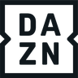</picture> | DAZN | — |

- Streaming in Africa. Every live event on its schedule ([dazn.com/en-KE/schedule](https://www.dazn.com/en-KE/schedule) – boxing, National League, LPB, T100, E1, OCEANMAN, Total Chess, RWS Muay Thai, padel and more) is read by the apps on your device and added automatically.

### NBA League Pass


*Direct-to-consumer streaming* · streaming

- **Watch:** [NBA League Pass](https://www.nba.com/watch/league-pass-stream)

| Logo | Channel | Number |
|:---:|---|---|
| <picture><source media="(prefers-color-scheme: dark)" srcset="logos/readme/channels/nba-league-pass-on-dark.png"></picture> | NBA League Pass | — |


### F1 TV


*Direct-to-consumer streaming* · streaming

- **Watch:** [F1 TV](https://f1tv.formula1.com)

| Logo | Channel | Number |
|:---:|---|---|
| <picture><source media="(prefers-color-scheme: dark)" srcset="logos/readme/channels/f1tv-on-dark.png"></picture> | F1 TV | — |


### MotoGP VideoPass


*Direct-to-consumer streaming* · streaming

- **Watch:** [MotoGP VideoPass](https://www.motogp.com/en/videopass)

| Logo | Channel | Number |
|:---:|---|---|
| <picture><source media="(prefers-color-scheme: dark)" srcset="logos/readme/channels/motogp-videopass-on-dark.png"></picture> | MotoGP VideoPass | — |


### Apple TV


*Streaming · every MLS match, Friday Night Baseball (in 100+ countries)* · streaming

- **Watch:** [Apple TV](https://tv.apple.com) · [MLS – how to watch](https://www.mlssoccer.com/how-to-watch/)

| Logo | Channel | Number |
|:---:|---|---|
| <picture><source media="(prefers-color-scheme: dark)" srcset="logos/readme/channels/apple-tv-on-dark.png"></picture> | Apple TV | — |

- Every MLS match (MLS Season Pass is included in Apple TV) and MLB Friday Night Baseball.

### beIN SPORTS France


*Madagascar · Mauritius · Réunion · Mayotte*

- **Watch:** [beIN SPORTS France](https://www.beinsports.com/france/)
- Indian Ocean islands; AFC Asian Cup rights (channel to be announced).

### Sport 24


*Live sport on airlines and cruise ships · Sport 24 & Sport 24 Extra (Emirates, Qatar Airways, Turkish Airlines, Etihad, Saudia, British Airways and more)*

- **Watch:** [Where to watch](https://sport24live.com/watch/) · [Schedule](https://sport24live.com/schedule/) · [Rights](https://sport24live.com/about/)

| Logo | Channel | Number |
|:---:|---|---|
| <picture><source media="(prefers-color-scheme: dark)" srcset="logos/readme/channels/sport24-on-dark.png"></picture> | Sport 24 | In flight · At sea |
| <picture><source media="(prefers-color-scheme: dark)" srcset="logos/readme/channels/sport24-extra-on-dark.png"></picture> | Sport 24 Extra | In flight · At sea |

- In-flight and at-sea only (no home TV in Africa). Rights (sport24live.com/about): UEFA Champions League, Europa League, Conference League, Nations League, Premier League, Ligue 1, Saudi Pro League, Women's Super League, Copa Libertadores, AFC Asian Cup, FIFA World Cup 26; Australian Open, Roland-Garros, Wimbledon, US Open, ATP Masters 1000 & ATP Finals; the Masters, The Open, PGA Tour, DP World Tour, LIV Golf, Ryder Cup; NFL, NBA, NHL; ICC Men's T20 World Cup, the Ashes, BBL; Rugby League World Cup, NRL, SVNS, Champions Cup; F1, MotoGP, SailGP, EuroLeague, BWF, AFL, horse racing majors. Live slots come from its 10-day schedule.

### Zuku TV

<picture><source media="(prefers-color-scheme: dark)" srcset="logos/readme/providers/zuku-dark.png"></picture>

*Satellite pay-TV · Kenya & East Africa (Wananchi Group) · sports: ESPN, ESPN 2, Punch TV, SportyTV, Liverpool TV*

- **Watch:** [Zuku TV](https://zuku.co.ke) · [Channel list](https://zuku.co.ke/channel-list/)

| Logo | Channel | Number |
|:---:|---|---|
| <picture><source media="(prefers-color-scheme: dark)" srcset="logos/readme/channels/zuku-punch-tv-on-dark.png">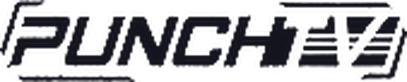</picture> | Punch TV | Zuku 714 |
| 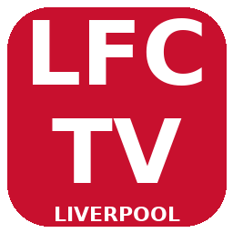 | Liverpool TV | Zuku 721 |

**Sports channels on Zuku** ([channel list](https://zuku.co.ke/channel-list/) – packages: Smart · Smart Plus · Classic · Premium)

| Channel | Zuku | Package |
|:---:|---|---|
|  | 712 | Smart and up |
|  | 713 | Smart Plus and up |
| <picture><source media="(prefers-color-scheme: dark)" srcset="logos/readme/channels/zuku-punch-tv-on-dark.png"></picture> | 714 | Smart and up |
|  | 720 | Smart and up |
|  | 721 | Premium |

- Sports rights on Zuku come through its channels: **Punch TV** (new, channel 714) – MMA, boxing, wrestling, kickboxing and other combat sports, live; **ESPN / ESPN 2** – NBA, NFL, MLB, Saudi Pro League, Top 14 and Japan Rugby League One; **SportyTV** – selected Premier League, LaLiga, Bundesliga, Serie A, Carabao Cup, NBA and combat sports; **Liverpool TV** (LFCTV) – Liverpool FC club channel. Zuku publishes no live TV guide, so matches are listed from the channels' own rights.

### Prime Video

<picture><source media="(prefers-color-scheme: dark)" srcset="logos/readme/providers/primevideo-dark.png">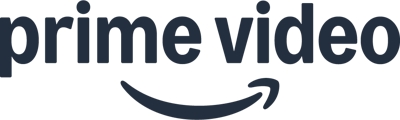</picture>

*Streaming · NBA games in South Africa and North Africa / Middle East (NBA on Prime, 11-year global deal from 2025-26)* · streaming

- **Watch:** [Prime Video](https://www.primevideo.com) · [NBA schedule (South Africa)](https://www.nba.com/schedule?cal=all&region=40) · [NBA schedule (Middle East & North Africa)](https://www.nba.com/schedule?cal=all&region=25)

| Logo | Channel | Number |
|:---:|---|---|
| <picture><source media="(prefers-color-scheme: dark)" srcset="logos/readme/channels/prime-video-on-dark.png"></picture> | Prime Video | Streaming · South Africa, North Africa & Middle East |

- **NBA on Prime Video** – part of the NBA's 11-year global media deal; Prime Video carries live NBA games in more than 200 countries. In Africa, nba.com lists Prime Video for about 60 games in **South Africa** and in the **Pan-Middle East** region, which includes North Africa (Egypt, Morocco, Algeria, Tunisia, Libya). Each game's Prime Video listing comes straight from nba.com's schedule.

### NFL Game Pass


*Direct-to-consumer streaming (DAZN)* · streaming

- **Watch:** [NFL Game Pass](https://www.dazn.com)

| Logo | Channel | Number |
|:---:|---|---|
| <picture><source media="(prefers-color-scheme: dark)" srcset="logos/readme/channels/nfl-gamepass-on-dark.png"></picture> | NFL Game Pass | — |

## How it updates itself

A GitHub job ([`.github/workflows/update-feed.yml`](.github/workflows/update-feed.yml)) runs **every 3 hours**. It reads the broadcasters' own live TV guides, keeps **live sport only** for the **next 10 days**, and rebuilds `feed.json` and the calendar files. Kick-off changes and new channel confirmations are picked up on the next run.

| Guide | How live sport is recognised | Status |
|---|---|---|
| <a href="https://supersport.com/tv-guide"></a><br>**SuperSport** – supersport.com/tv-guide | the guide's own "live" flag | ✅ |
| <a href="https://www.beinsports.com/en-mena/tv-guide"></a><br>**beIN SPORTS MENA** – beinsports.com/en-mena/tv-guide | the guide's own "live" flag | ✅ |
| <a href="https://www.myt.mu/home/new-world-sport-guide"></a><br>**New World Sport** – myt.mu/home/new-world-sport-guide | the guide lists only live events | ✅ |
| <a href="https://web.azamtvmax.com/tv-guide"></a><br>**Azam TV Max** – web.azamtvmax.com/tv-guide | "LIVE" in the programme title | ✅ (Azam publishes one day at a time) |
| <a href="https://m.startimestv.com"><picture><source media="(prefers-color-scheme: dark)" srcset="logos/readme/platforms/startimes-dark.png"></picture></a><br>**StarTimes** – m.startimestv.com | no live flag: a slot counts only if it starts within 30 minutes of the real kick-off (so replays never count) | ✅ |
| <a href="https://sport24live.com/schedule/"><picture><source media="(prefers-color-scheme: dark)" srcset="logos/readme/platforms/sport24-dark.png"></picture></a><br>**Sport 24 / Sport 24 Extra** – sport24live.com/schedule (airlines & cruise ships) | the schedule's own live flag | ✅ |
| <a href="https://www.nba.com/schedule?cal=all&region=24"><picture><source media="(prefers-color-scheme: dark)" srcset="logos/readme/channels/nba-league-pass-on-dark.png"></picture></a><br>**NBA** – nba.com/schedule (Broadcaster region: Pan-Africa, Pan-Middle East and South Africa) | the official list of each game's international broadcasters (CANAL+ Afrique, SuperSport Action, ESPN, SportyTV, beIN SPORTS, Prime Video); merged with the TV guides and Sport 24 | ✅ (feed every 3 h, apps every 2 h) |
| <a href="https://www.dazn.com/en-KE/schedule"><picture><source media="(prefers-color-scheme: dark)" srcset="logos/readme/platforms/dazn-dark.png"></picture></a><br>**DAZN** – dazn.com/en-KE/schedule (streaming, Africa) | every scheduled event is live; programmes, the Live TV channel and add-on passes (NFL Game Pass, NHL.TV) are left out. DAZN refuses requests from servers outside Africa, so **the apps read its 10-day schedule directly on your phone or PC** each refresh | ✅ in the apps |
| <a href="https://www.azamtv.com/program-guide"><picture><source media="(prefers-color-scheme: dark)" srcset="logos/readme/platforms/azamtv-dark.png"></picture></a><br>**Azam TV** – azamtv.com/program-guide | checked every run; its sports section currently lists ESPN only | ⚠️ |
| <a href="https://www.canalplus.com/rw/programme-tv/"><picture><source media="(prefers-color-scheme: dark)" srcset="logos/readme/platforms/canalplus-dark.png"></picture></a><br>**CANAL+ Rwanda** – canalplus.com/rw/programme-tv | blocks automated visits from cloud servers | ⚠️ use announcements |
| <a href="https://www.zap.co.ao/tv/guia-tv"></a><br>**ZAP Angola** – zap.co.ao/tv/guia-tv | guide server only answers inside Angola | ⚠️ use announcements |

Each run's result per guide is in `feed.json → sources`. A guide that fails keeps its last good data instead of wiping it.

## Calendars (subscribe once, updates by itself)

- All live sport: `https://raw.githubusercontent.com/Kigakhemet98/asbh-feed/main/calendar.ics`
- One sport: `https://raw.githubusercontent.com/Kigakhemet98/asbh-feed/main/calendars/<sport>.ics` (football, basketball, rugby, cricket, tennis, f1, …)

Google Calendar → *Other calendars → From URL*; Outlook → *Add calendar → Subscribe from web*; iPhone/Mac → *Add Subscription Calendar* (or open the `webcal://` version of the link). The apps' **Add to calendar** button offers these links too.

## Adding a broadcaster announcement by hand

Edit [`manual.json`](manual.json) (not `feed.json`, which is rebuilt automatically):

```json
{ "date": "2026-11-12", "teams": ["Cameroon", "Namibia"], "channels": ["cp-sport-3"], "source": "CANAL+ graphic" }
```

`date` is the match day in East Africa Time. Team names can be in English or French. Channel IDs are in [CHANNEL-IDS.md](CHANNEL-IDS.md). Saving `manual.json` starts a rebuild straight away. Past dates are ignored automatically.
